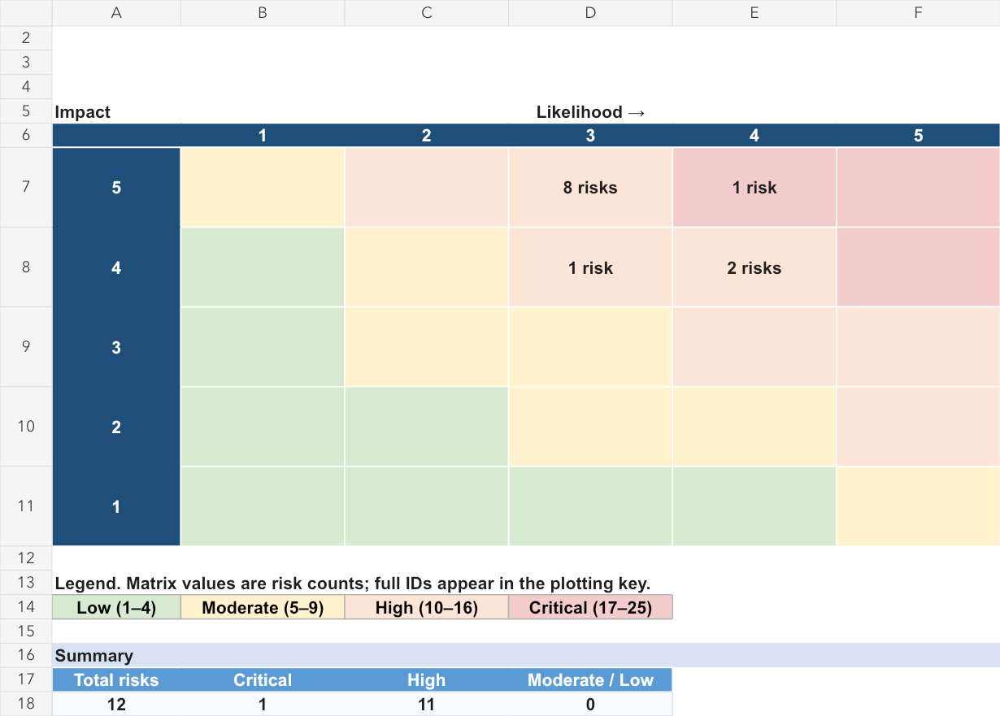

# Northstar Payment Systems — GRC Assessment Portfolio

An academic cybersecurity governance, risk, and compliance case study for a **fictional payment services provider**. The project connects control observations to business risks and a practical remediation roadmap using synthetic evidence.

The assessment covers **12 control areas**, **27 simulated evidence artifacts**, and **12 documented risks**. It demonstrates how to evaluate imperfect records, distinguish confirmed observations from missing evidence, and communicate recommendations without overstating what a sample proves.

## Executive overview

All 12 controls are rated **Partially Met** against the project’s documented control objectives. The samples show some implementation alongside specific accountability, review, documentation, or validation gaps. These ratings apply to the exercise records, rather than an entire operating environment.

The inherent risk estimates classify **one risk as Critical and eleven as High**. Scores use the project’s 5 × 5 likelihood–impact model; they are structured judgments, not measured probabilities. Remediation actions remain open, and planned changes are not treated as implemented risk reduction.

## Start here

| File | What it contains |
| --- | --- |
| [Project Charter and Assessment Plan (PDF)](Northstar_PDFs/01_Northstar_Project_Charter_and_Assessment_Plan.pdf) ([Word](northstar-grc-assessment/01_Northstar_Project_Charter_and_Assessment_Plan.docx)) | Fictional scenario, scope assumptions, assessment method, and rating definitions. |
| [Control Assessment Matrix (PDF)](Northstar_PDFs/02_Northstar_Control_Assessment_Matrix.pdf) ([Excel](northstar-grc-assessment/02_Northstar_Control_Assessment_Matrix.xlsx)) | The gap assessment: design, implementation, operation, findings, ratings, rationale, and recommendations. |
| [Risk Register (PDF)](Northstar_PDFs/03_Northstar_Risk_Register.pdf) ([Excel](northstar-grc-assessment/03_Northstar_Risk_Register.xlsx)) | Risk scenarios, business impacts, score rationales, existing safeguards, treatment, and uncertainty. |
| [Evidence Register (PDF)](Northstar_PDFs/04_Northstar_Evidence_Register.pdf) ([Excel](northstar-grc-assessment/04_Northstar_Evidence_Register.xlsx)) | Evidence IDs, control associations, artifact paths, and sample limitations. |
| [Remediation Roadmap (PDF)](Northstar_PDFs/Northstar_Remediation_Roadmap.pdf) ([Excel](northstar-grc-assessment/Northstar_Remediation_Roadmap.xlsx)) | Prioritized actions, proposed owner roles, target dates, dependencies, and closure evidence. |
| [Risk Heat Map (PDF)](Northstar_PDFs/Northstar_Risk_Heat_Map.pdf) ([Excel](northstar-grc-assessment/Northstar_Risk_Heat_Map.xlsx)) | Inherent risk distribution and a comparison with recorded residual estimates. |
| [Evidence folder](northstar-grc-assessment/Evidence/) | The 27 synthetic CSV and document artifacts supporting the case. |

The PDF copies present the same assessment entries in a reading layout. Use the Excel files for filtering and editing.

For a quick review, start with the matrix, follow one evidence ID into the Evidence folder, and trace the related risk into the roadmap.

Download and extract the repository, then open the Excel workbooks and Word documents inside `northstar-grc-assessment/`. Keep its `Evidence/` folder beside the assessment files so the Evidence Register's relative paths resolve.

## Selected findings

- **Privileged access:** PA-010 is active with unassigned ownership, no supplied approval record, and unknown MFA enforcement. “MFA configured” does not establish enforcement or a successful authentication outcome. See CTL-05 / R-001 and the [account inventory](northstar-grc-assessment/Evidence/CTL-05_Privileged_access_and_MFA/E-005-01_Privileged_Account_Inventory.csv) and [MFA configuration sample](northstar-grc-assessment/Evidence/CTL-05_Privileged_access_and_MFA/E-005-02_MFA_Configuration_Report.csv).
- **Access reviews:** USR-023 and USR-024 are explicitly unreviewed. Their “Active in export” annotation appears in the Approval field, so actual enabled-account status requires confirmation before concluding that former personnel retained access. See CTL-04 / R-004 and the [user roster](northstar-grc-assessment/Evidence/CTL-04_Access_lifecycle_and_access_reviews/E-004-01_User_Access_Roster.csv) and [review sample](northstar-grc-assessment/Evidence/CTL-04_Access_lifecycle_and_access_reviews/E-004-02_Quarterly_Review_Sample.csv).
- **Vulnerability follow-up:** VUL-02 is recorded overdue, and VUL-03 has an expired exception without recorded reassessment. VUL-01’s October 20 target falls after the declared October 15 assessment cutoff and is not treated as overdue at that cutoff. See CTL-07 / R-006 and the [remediation and exception records](northstar-grc-assessment/Evidence/CTL-07_Vulnerability_management/E-007-02_Remediation_and_Exceptions.csv).
- **Vendor oversight:** The critical processor’s assurance report is pending, while incident-notification terms remain open without documented risk acceptance. This supports an oversight gap, not a conclusion that the processor’s controls failed. See CTL-03 / R-002 and the [vendor actions](northstar-grc-assessment/Evidence/CTL-03_Third_party_risk_management/E-003-02_Vendor_Actions.csv).

## Assessment workflow

1. Define each control objective and the records needed to evaluate it.
2. Inspect and reconcile evidence IDs, record identifiers, dates, statuses, and exceptions.
3. Separate design observations, implementation evidence, and operating results; document limitations before assigning ratings.
4. Develop conditional risk scenarios and explain likelihood, impact, and residual-risk assumptions.
5. Prioritize corrective actions and specify evidence required to validate closure.

## Scope and limitations

The declared sample window is **October 1–15, 2026**. Some artifacts are older or undated; the matrix records those limitations. Small summaries and missing underlying configurations, tickets, or assurance reports prevent full-population or continuous-operation conclusions.

**NIST CSF 2.0** organizes the control areas. **PCI DSS v4.0.1 and SOC 2 references remain proposed**, with applicability and mappings unverified. This is an objective-based portfolio simulation, not a formal audit, compliance validation, attestation, or production security test.

## Skills demonstrated

Evidence reconciliation, control-gap analysis, risk documentation, uncertainty handling, remediation planning, and clear communication across linked assessment workbooks.

